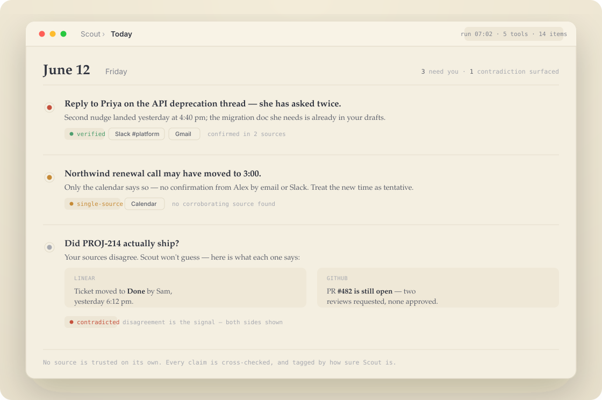
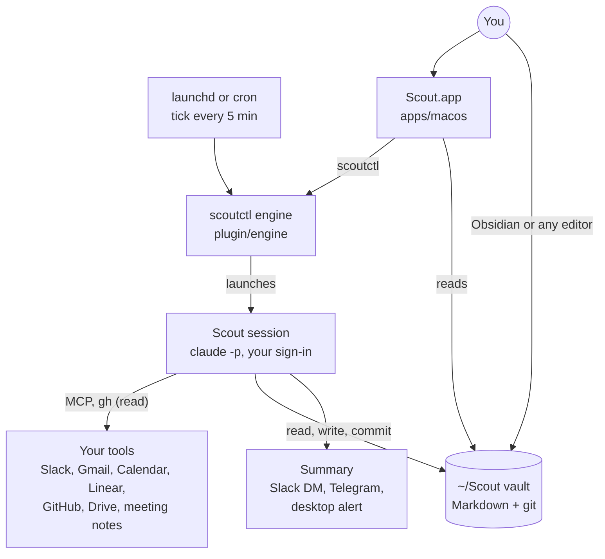

<div align="center">


# Scout

**Start every day knowing what actually needs you.**

An open-source background agent for [Claude Code](https://docs.claude.com/claude-code). Scout reads your work tools on a schedule,
cross-checks them, and leaves you a short, sourced list of what needs you, plus a knowledge base of plain Markdown you own.

[](https://github.com/Raven-Scout/Scout/releases/latest)
[](https://github.com/Raven-Scout/Scout/actions/workflows/plugin-test.yml)
[](#requirements)
[](LICENSE)

[**Download for Mac**](https://github.com/Raven-Scout/Scout/releases/latest) ·
[Website](https://raven-scout.github.io/Scout/) ·
[Quick start](#quick-start) ·
[How it works](#how-it-works) ·
[Docs](#documentation) ·
[For AI agents](#for-ai-agents-and-contributors) ·
[Changelog](plugin/CHANGELOG.md)

<br>



<sub>Illustration of a morning briefing. Names and items are invented.</sub>

</div>

---

Scout runs as a handful of short, scheduled Claude Code sessions on your own machine. Each one reads what changed in
Slack, email, your calendar, tickets, pull requests and meeting notes, checks the sources against each other, and
writes the result into `~/Scout` as a git commit you can read and undo. You get a daily list you can trust, because
every item says how sure it is, and a knowledge base of linked Markdown that opens in any editor or in Obsidian.

> [!NOTE]
> Scout runs on **your own Claude Code sign-in**, with no separate API key, no Scout account and no Scout server.
> It needs a paid Claude plan; each run counts against your plan's usage like any other Claude Code session.

## Quick start

**The Mac app (recommended).** Onboarding sets everything up.

1. Download the latest `Scout-x.y.z.dmg` from [Releases](https://github.com/Raven-Scout/Scout/releases/latest).
2. Drag **Scout.app** into Applications and open it. It's signed and notarized.
3. Onboarding does the rest: it checks for Claude Code (and opens Anthropic's installer if it's missing), installs the
   engine and registers it with Claude Code, asks for your name, email, tools and daily budget, creates your vault
   (`~/Scout` by default) and schedules the runs.

**From the terminal (no app).** Installs the Claude Code plugin and the engine, asks the same questions, and creates
`~/Scout`. It needs no Homebrew or Python, and it is the way in on Linux.

```bash
curl -fsSL https://raw.githubusercontent.com/Raven-Scout/Scout/main/install.sh | bash
```

Then, in Claude Code, check that everything is healthy:

```text
/scout-status
```

Both paths install the **latest release**, never unreleased work on `main`: the marketplace entry pins the plugin to the
`stable` branch, which moves only when a release is published. Already set up from the terminal? Scout.app adopts the
existing install as-is and never modifies an install it didn't create. You can [read `install.sh`](install.sh) first.

### Requirements

| You need | Details |
|---|---|
| **Claude Code** | Installed and signed in. Each run is a headless `claude -p` session under your login. |
| **A paid Claude plan** | Max is recommended: a weekday is about eight runs. A daily cap, a per-run cap and a five-hour limit keep usage in check. |
| **The Mac app** | macOS 15.7 or later. |
| **The engine** | macOS or Linux (the terminal install). There's no Windows support. |
| **Your tools** | Connected to Claude, for example at [claude.ai/settings/connectors](https://claude.ai/settings/connectors). Any subset works. |

## Why Scout

| Your work today | What Scout does about it |
|---|---|
| **It's scattered.** The thing that matters is half in a Slack thread, half in an email, and the rest in a ticket. | Reads every tool you've connected and puts the pieces together into one list. |
| **It goes stale.** Notes are out of date a week later; the tracker says "done" while the pull request is still open. | Rechecks through the day, and keeps project pages to a one-screen summary that a nightly pass rebuilds. |
| **Summaries sound sure.** An AI summary reads the same whether three sources agree or one person said it once. | Tags every item `verified`, `single-source` or `contradicted`, and shows both sides when your tools disagree. |

## What you get

<table>
<tr>
<td width="50%" valign="top">

### ✅ A list you can trust
No single tool is taken at its word. A meeting invite is checked against the transcript, a ticket against its pull
request. Each item carries its sources and how sure Scout is.

</td>
<td width="50%" valign="top">

### 📁 A knowledge base you own
People, projects and decisions become linked Markdown in `~/Scout`. One-screen project pages, with the detail in
cited notes. Open it in any editor or in Obsidian.

</td>
</tr>
<tr>
<td valign="top">

### 🔁 Undo anything
The vault is a git repository and every run is a commit with a readable message, including the changes Scout makes
to its own instructions. `git revert` any of them.

</td>
<td valign="top">

### 🌙 It reviews its own day
Evening "dreaming" runs read your 👍 and 👎, log Scout's mistakes and fix its instructions. Bigger changes become
proposals that apply after a few days unless you reject them.

</td>
</tr>
<tr>
<td valign="top">

### 🖥️ A menu-bar app
Scout.app shows today's items, what's running and whether anything needs you. It alerts you when runs stop working,
for example an expired sign-in, and keeps itself and its engine up to date.

</td>
<td valign="top">

### 🎛️ Your model, your budget
Pick Opus, Sonnet or Haiku for each scheduled run. Set a daily cap and a per-run cap; runs back off after failures and
pause at your plan's usage limit instead of failing.

</td>
</tr>
<tr>
<td valign="top">

### 🔒 Private by design
Notes, logs and settings stay on your machine. Mark a note private or local-only, and privacy checks run before every
commit. No analytics. Details in [PRIVACY.md](PRIVACY.md).

</td>
<td valign="top">

### 💬 Work through it with you
In Claude Code, `/scout-work` walks through today's items and acts only when you say yes. `/scout-ask` answers
questions from your notes.

</td>
</tr>
</table>

## A day with Scout

These are the default times. You can move them, pick each run's model, or turn runs off, in the app or in
`~/Scout/.scout-state/schedule.yaml`. If your machine is asleep, missed runs catch up later.

| When | Run | What it does |
|---|---|---|
| 08:00 weekdays · 08:30 weekends | **Morning briefing** | Reads every connected tool and the knowledge base, cross-checks them, and writes today's action items. |
| 11:00 · 13:00 · 17:00 · 19:00 weekdays | **Consolidation** | Looks only at what changed since the last run (a reply, a merged pull request, a moved meeting) and updates the list. |
| 14:00 weekdays | **Research** | Picks the thinnest or stalest part of the knowledge base and fills it in from the web, docs and your tools. |
| 18:30 · 22:00 daily | **Dreaming** | Processes your feedback, logs mistakes, improves Scout's own instructions, and works its wishlist. |
| Whenever you like | **You, in Claude Code** | `/scout-work`, `/scout-plan`, `/scout-ask` and `/scout-status`. See [commands](#commands). |

After each run you can get a short summary as a Slack DM or a Telegram message. Reply 👎 with a one-line fix, and the
next dreaming run learns from it.

## How it works



- **The plugin** ([`plugin/`](plugin)) holds the slash commands, skills, hooks, and the *phase modules*: small Markdown
  instructions that setup assembles into self-contained "brain files" (`SKILL.md`, `DREAMING.md`, `RESEARCH.md`) in
  your vault, matched to the tools you connected. You can edit them; upgrades three-way merge instead of overwriting.
- **The engine** ([`plugin/engine/`](plugin/engine)) is `scoutctl`, a Python CLI. It installs the vault and the
  schedule, dispatches runs, enforces the budget, checks privacy at commit time, and reports run health.
- **A session** is one unattended Claude Code run. It is the only part that talks to your tools, and it writes its
  result to the vault as one commit.
- **The app** ([`apps/macos/`](apps/macos)) is a SwiftUI menu-bar app that reads the vault and drives the engine
  through `scoutctl`. It is optional: the terminal install runs the same engine and schedule.

The full C4 model (context, containers, components, deployment and one scheduled run) is in
[`docs/architecture/`](docs/architecture/README.md).

### Works with

Slack · Gmail · Google Calendar · Google Drive · Linear · GitHub · Granola · Fathom · WhatsApp · Google Messages, plus
your local Claude Code sessions. Scout can also draft a **read-only custom connector** for any other tool you've
connected to Claude Code (`/scout-connect`); the draft check rejects any tool that sends, posts, creates, updates or
deletes. The roster lives in [`plugin/engine/scout/connectors.yaml`](plugin/engine/scout/connectors.yaml).

### Commands

| In Claude Code | What it does |
|---|---|
| `/scout-status` | Config, last runs, knowledge-base health, budget, pending proposals. |
| `/scout-work` | Walk through today's items one at a time, with a draft for each, and act only on your yes. |
| `/scout-plan` | Plan the day on a 15-minute grid and add calendar blocks after you approve. |
| `/scout-ask` | Answer a question from the knowledge base, checking live tools only when the record is stale. |
| `/scout-connect` | Add or remove a custom connector. |
| `/scout-update` | Upgrade the plugin and your vault without overwriting your edits. |
| `/scout-briefing` · `/scout-consolidation` · `/scout-dream` · `/scout-research` | Start a run now, in the background. |
| `/scout-meta-review` | Audit Scout itself: are runs happening, are mistakes trending down, are proposals flowing? |

In a terminal, `scoutctl --help` lists the engine's commands; `scoutctl bootstrap doctor` and `scoutctl health` are the
first stops when something looks wrong.

## FAQ

<details>
<summary><b>What does it cost?</b></summary>

Scout is free and MIT licensed. Its runs use your Claude plan's usage, like any other Claude Code session. A daily
cap, a per-run cap and a rolling five-hour limit keep that in check (`scoutctl budget show`), and you can move any
run to a cheaper model.
</details>

<details>
<summary><b>Does my data go to you?</b></summary>

No. There is no Scout account, server or analytics. To do its work, Scout sends content from your tools to Claude
under your own Claude account, and reads your tools under your own sign-ins. On top of that, the Mac app checks
GitHub for updates once a day, and, only if you turn on sharing, the folders you choose upload to the place you link.
See [PRIVACY.md](PRIVACY.md).
</details>

<details>
<summary><b>Do I need the Mac app?</b></summary>

No. The terminal install runs the same engine and the same schedule. The app adds the menu-bar panel, the Control
Center, settings, alerts and automatic updates.
</details>

<details>
<summary><b>What about Linux and Windows?</b></summary>

The app is macOS only (15.7 or later). The engine runs on Linux through the terminal install, scheduled with cron.
There's no Windows support.
</details>

<details>
<summary><b>Scout has gone quiet. What now?</b></summary>

Almost always your Claude Code sign-in has expired. Run `claude auth login`; the next run picks it up. To stop it
happening again, give scheduled runs a long-lived token with `scoutctl auth setup-token`. For anything else, start
with `scoutctl bootstrap doctor`. More in the plugin's [troubleshooting FAQ](plugin/README.md#faq--troubleshooting).
</details>

<details>
<summary><b>Do I need Obsidian?</b></summary>

No. The knowledge base is plain Markdown with `[[wikilinks]]`. Obsidian gives you a graph view, but any editor works.
</details>

<details>
<summary><b>I installed from <code>Raven-Scout/scout-plugin</code>. Do I need to do anything?</b></summary>

No. This repository *is* scout-plugin, renamed to `Raven-Scout/Scout` when the macOS app moved in, and GitHub
redirects the old name, so `/scout-update` keeps working. The app's pre-move repository, issues and releases are
archived at [`Raven-Scout/scout-app-legacy`](https://github.com/Raven-Scout/scout-app-legacy).
</details>

## Documentation

| Read this | For |
|---|---|
| [Website](https://raven-scout.github.io/Scout/) | The short tour. |
| [`plugin/README.md`](plugin/README.md) | The full reference: install options, session types, connectors, knowledge graph, budget, customization, troubleshooting. |
| [`apps/macos/README.md`](apps/macos/README.md) | The Mac app: features, settings, updates, building from source. |
| [`docs/architecture/`](docs/architecture/README.md) | C4 diagrams of the plugin and engine. |
| [`plugin/CHANGELOG.md`](plugin/CHANGELOG.md) · [`apps/macos/CHANGELOG.md`](apps/macos/CHANGELOG.md) | What changed in each release. |
| [`docs/superpowers/specs/`](docs/superpowers/specs) | Design specs behind the larger features. |
| [PRIVACY.md](PRIVACY.md) · [TERMS.md](TERMS.md) | What Scout does with your data, and the terms of use. |

## For AI agents and contributors

This repo ships two artifacts from one version. **Work in the subtree that owns the change, and read its `CLAUDE.md`
first**: they use different languages, test runners and release steps. The root [`CLAUDE.md`](CLAUDE.md) holds the
rules that span both.

| Path | What it is | Language | Read first |
|---|---|---|---|
| [`plugin/`](plugin) | Claude Code plugin: commands, skills, hooks, phase modules, templates | Markdown, Bash | [`plugin/CLAUDE.md`](plugin/CLAUDE.md) |
| [`plugin/engine/`](plugin/engine) | The `scoutctl` engine | Python 3.11+ | [`plugin/CLAUDE.md`](plugin/CLAUDE.md) |
| [`apps/macos/`](apps/macos) | Scout.app, the menu-bar app | Swift, SwiftUI | [`apps/macos/CLAUDE.md`](apps/macos/CLAUDE.md) |
| [`docs/`](docs) | The website (`index.html`), architecture, specs and plans | HTML, Markdown | [`docs/README.md`](docs/README.md) |
| [`scripts/`](scripts) | `release.sh` and the self-update e2e harness | Bash | [`scripts/e2e/self-update/README.md`](scripts/e2e/self-update/README.md) |
| [`.claude-plugin/marketplace.json`](.claude-plugin/marketplace.json) | The marketplace manifest. It lives at the repo root. | JSON | [`CLAUDE.md`](CLAUDE.md) |

**Run only the tests your change affects.** CI runs the full matrix and is the gate.

```bash
# Engine (from plugin/engine)
uv venv --python 3.12 && uv pip install -e ".[dev]"
.venv/bin/pytest tests/unit/test_<area>.py               # the tests for what you touched
.venv/bin/ruff check scout tests && .venv/bin/ruff format --check scout tests
.venv/bin/mypy scout
.venv/bin/python -m scout.scripts.versioning check      # one version across every file

# App (from apps/macos; needs Xcode 26 or newer)
xcodebuild test -scheme Scout -destination 'platform=macOS' -only-testing:ScoutTests/<SuiteName>
```

**Rules that break things when ignored:**

- **One version, one tag, one release.** The app and the plugin share one `X.Y.Z`, tagged `vX.Y.Z` and cut with
  `scripts/release.sh`. `versioning check` (CI: `plugin-lint` and `contract`) fails on drift. Never create `app/v*`
  or `plugin/v*` tags.
- **Contract artifacts are generated, never hand-edited.** The connector roster, the schedule snapshot, the parser
  corpus and the doctor fixture each have one canonical file under `plugin/engine/`, and the app holds byte copies that
  `contract.yml` compares. Never edit a `*.snapshot.json` by hand. The regenerate-and-copy steps are in
  [`CLAUDE.md`](CLAUDE.md).
- **`.claude-plugin/marketplace.json` lives at the repo root** and pins the plugin to the `stable` branch. Everything
  the plugin needs at runtime must stay under `plugin/`.
- **A change that spans both subtrees lands as one commit**, with `contract.yml` as the gate.
- **This repo is public.** Fixtures and examples use the shared stand-ins (`Alex`, `Priya`, `Sam`, `PROJ-1234`,
  `example-org/<repo>`), never real people, companies or identifiers.
- **A new behavioural rule in `plugin/phases/`** should come with an eval seed; the PR template asks.

<details>
<summary><b>For maintainers: cutting a release</b></summary>

<br>

Every release is one GitHub release tagged `vX.Y.Z`, cut with `scripts/release.sh prepare` and then `finalize`.
Publishing it fast-forwards the `stable` branch, which marketplace installs read. Release candidates
(`vX.Y.Z-rc.N`, cut with `rc` from `release/vX.Y.Z`) never move it. The earlier `plugin/vX.Y.Z` and `app/vX.Y.Z` tags
are history.

Before merging the release PR, the maintainer runs these locally on their own Claude login. CI never runs them,
because they spend model usage. `release.sh prepare` prints each step.

1. **KB-writing gate (blocking).** `plugin/scripts/eval.sh kb-gate` runs one consolidation session (Sonnet; `--opus`
   for Opus) on a throwaway copy of a synthetic vault, feeds it a day of new signals about one project, and fails if
   the run broke the project's front page:
   - `kb structure` no longer shows the folder ✓;
   - the front page grew by more than 512 bytes (`--max-growth N`);
   - the new facts didn't land in the project's `knowledge/` notes, cited to a URL or to an existing source or
     meeting note;
   - the front page gained narration, a dated or "update" bullet, a new paragraph, or a bullet over the 300-character
     cap.

   Exit 0 is a pass, 1 a fail, 2 a run that couldn't be scored. Paste the JSON report it prints (also saved as
   `kb-gate-report.json` in the result dir) into the release PR, check that the commit it names is the release
   branch's head, and don't merge on a fail. `plugin/scripts/eval.sh kb-score <result dir>/vault` re-scores a kept run
   without starting a session.
2. **Agent-behaviour eval (a reminder, not a gate).** `plugin/scripts/eval.sh run <scenarios>`, or
   `plugin/scripts/eval.sh compare <scenarios> --base <last tag>` when `plugin/phases/` changed. Paste the summary
   into the release PR.
3. **Headless self-update rehearsal (not a gate).** `scripts/e2e/self-update/run.sh --from <last tag> --to
   release/vX.Y.Z` in a throwaway Linux container, or the manual **e2e-self-update** workflow. The release PR has a
   checkbox for it. See [`scripts/e2e/self-update/README.md`](scripts/e2e/self-update/README.md).

</details>

## Community and license

| Where | Best for |
|---|---|
| [Issues](https://github.com/Raven-Scout/Scout/issues) | Bugs, feature ideas and questions about setup. |
| [Security policy](https://github.com/Raven-Scout/.github/blob/main/SECURITY.md) | Reporting a vulnerability privately. Please don't open a public issue for one. |
| [Pull requests](https://github.com/Raven-Scout/Scout/pulls) | Fixes and features. Read [For AI agents and contributors](#for-ai-agents-and-contributors) first. |
| [Code of conduct](https://github.com/Raven-Scout/.github/blob/main/CODE_OF_CONDUCT.md) | How we work together. |

Scout is [MIT licensed](LICENSE). See also [PRIVACY.md](PRIVACY.md) and [TERMS.md](TERMS.md).
Scout is an independent project and is not affiliated with, endorsed by or sponsored by Anthropic or any other company.
